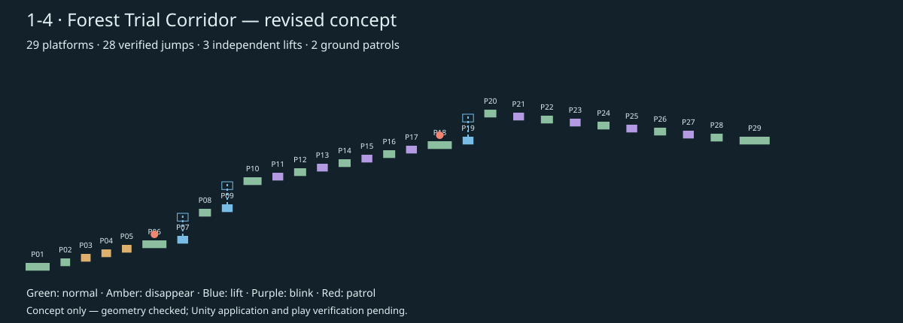

<!-- Codex (GPT-6), 2026-10-15. Reviewed current project rules and previous applied design; created revised concept, generator and numerical checks. -->
# 1-4 수정 설계 — 숲의 시련 회랑

상태: **2026-10-15 Unity 적용 완료 / 구조·제어된 물리 검사 통과 / 직접 조작 연속 완주 검증 대기**. 2026-10-08 적용 기록과 구분되는 후속안이다. 설계 작성 후 사용자의 적용 지시에 따라 Stage1에 반영했다. 상세 결과는 [Unity 적용·검수 기록](Stage14_Revision_Implementation_20261015.md)을 참조한다.

<!-- Codex (GPT-6), 2026-10-15. User-authorized application: 100 structure, 145 runtime and 9 boosted-walk checks passed. -->

## 부적합 사항과 수정

| 기존 설계의 문제 | 수정안 |
|---|---|
| Sliced·테두리0으로 발판 전체 그림을 늘림. 최신 MapEdit의 Tiled/Continuous 기준과 충돌 | Scale1, 전용 반복용 숲 타일, Tiled/Continuous, 명시적 Renderer.size·Collider.size 일치 |
| 연속 리프트 P07/P08 모두 속도1.6. 지연만 다르게 설정해 MapEdit23의 속도 차이 누락 | 리프트 사이 고정 안전대 추가. 새 P07/P09/P19 속도3.2/3.6/4.0, 지연0/0.35/0.70초 |
| 두 리프트를 직접 건너는 동선이 위상 일치에 의존. 속도 수정 시 기존2.90초 지연의 동기 근거가 무효 | 새 P08에서 대기 후 두 번째 리프트에 독립 탑승. 리프트끼리 직접 환승하지 않음 |
| 기존 하강 빈틈3.2·높이차−0.6의 필요거리약4.38이 최대도달약5.38의80%인약4.30을 초과 | 하강 빈틈2.8·높이차−0.4. 최대 가속에서도 무점프 통과 불가, 기본 점프의80% 범위 안에서 도달 |
| 이전 생성기의 검사는 최대 점프만 비교하면서80% 기준 충족을 입증하지 않음 | 28개 연결 전부80% 최대 도달거리 검사와 점프 초속80% 검사 추가 |
| 이전 문서·생성 결과의 Unity 적용 완료 문구가 새 설계에도 오인될 수 있음 | 기존 기록은 이력으로 보존. 이번 수정안·생성기는 별도 이름으로 저장하고 미적용 상태 명시 |

기존 동선의 다섯 종류 발판·지상 몬스터2마리·종료 후1-5 이동 의도는 유지한다. 앞선 문서가 이미 고친 과거의 좁은 틈·발판 겹침 등을 현재 씬의 새 결함으로 중복 판정하지 않는다. 이번 문제 판단은 저장 문서·코드·프리팹 설정의 정적 검토다.

## 수정 동선

★ P01 시작 → P02 점프 → P03~05 소멸 계단 → P06 전투1 → P07 리프트 → **P08 고정 안전대** → P09 리프트 → P10 휴식 → P11/13/15/17 점멸과 일반대 교대 → P18 전투2 → P19 리프트 → P20 안전대 → P21/23/25/27 점멸 발판과 일반대 교대 하강 → P29 골인 → 1-5.

총 **29개**: 일반15·소멸3·이동3·점멸8. (2026-10-16: 피해 발판4개를 점멸로 교체, Unity 반영 완료) 기존28개에 리프트 사이 안전대1개를 추가했다. 새 P09 이후 ID는 기존보다1씩 증가한다. 몬스터는 P06/P18 위에 배치한다.

전체 좌표·28개 연결별 검증표는 [수치 검증 및 배치표](Stage1-4_Revision_Validation.md)를 기준으로 한다. JSON은 `MapDesign_Stage1-4_Revision.json`, 재생성 코드는 `Generate_Stage1-4_Revision.ps1`이다. 원본 `Design_Stage1-4.ps1`을 실행해 이번 수정안으로 간주하지 않는다.

## 거리·점프 기준

저장된 Player_Warrior 설정의 이동8·점프9·중력배율3과 Physics2D 중력9.81을 사용한다. 유효 중력29.43, 몸폭은7.55×0.130208≈0.983이다. 기본 이동8에서 거리1은8유닛이다. 가속을 요구하지 않는다.

- 상승: 높이차+0.6, 빈틈1.8, 필요거리2.983. 최대 도달거리의80%≈3.427 및 점프 초속80% 도달거리≈3.062 안에 포함된다.
- 하강: 높이차−0.4, 빈틈2.8, 필요거리3.983. 최대 도달거리의80%≈4.181, 점프 초속80% 도달거리≈4.317 안에 포함된다.
- 최대 가속 이동10에서도 하강 무점프 도달 한계는 몸폭 포함≈2.632로 빈틈2.8보다 작다. 몬스터 가속 드롭을 획득해도 점프가 필요한 구조를 유지한다.
- 필요거리는 빈틈에 몸폭 전체와 이착륙 여유0.2를 더한 보수적 값이다. 80% 최대 도달 검사와80% 점프 초속 검사는 각각 별도 조건이며 이동·점프를 동시에80%로 낮춘다는 뜻은 아니다.
- 높이·수평 거리의 탄도 산술만 검증한다. 실제 입력 타이밍·발끝 접촉·점프 보정·리프트 운반은 구현 때 확인한다.

## 리프트와 시간성 발판

리프트 P07/P09/P19는 수직 편도3유닛, PingPong, 양 끝1초 정지다. 속도는 각각3.2/3.6/4.0, 시작 지연0/0.35/0.70초다. 경로는 하단·상단의 명시적2점으로 저장하며 런타임 잔류 위치를 원점으로 재사용하지 않는다.

각 탑승·하차는 해당 끝점 정지 중에 수행한다. 기본 점프 비행시간과0.08초 오차를 제외한 출발 창은 약0.385초다. 같은 기준에서 창을 놓쳤을 때 다음 창까지 최대 대기 추산은 약3.49/3.28/3.12초다. 기존 속도1.6·끝점1초의 왕복주기5.75초보다 짧게 설계했다. 독립 안전대가 있어 두 발판의 위상 동기화가 필수 조건이 아니다.

- 소멸 P03~05: vanishDelay0.9, respawnDelay2.0 유지. 밟은 후 발을 떼도 소멸 예약 유지. 이동 공격이나 아이템 수집을 강제하지 않는다.
- 점멸 P11/13/15/17: visibleDuration2.4, invisibleDuration1.2, startDelay0/0.45/0.90/1.35. 전후 일반 발판에서 외형을 보고 진입한다. 도착만 아니라 다음 안전대에 이륙할 때까지 발판이 보이는 출발 창이 있어야 한다. 단순 도착 가능만으로 무피해 통과를 보장하지 않는다.
- 점멸 P21/23/25/27(구 피해 발판, 2026-10-16 교체): visibleDuration2.4, invisibleDuration1.2, startDelay0/0.45/0.90/1.35. 위치·폭1.8은 유지하고 P11과 같은 점멸 프리팹으로 교체했다. 피해 효과는 없으며 일반대에서 점멸 상태를 확인한 뒤 건너는 동선이다.
- 처음 진입·재시작 시 기믹의 초기 위상을 재현한다. 영역 밖에서 흘러간 시간으로 소멸 예약·중간 리프트 위치를 넘겨받지 않는 초기화 규칙은 구현 항목이다. 공용 동작을 수정할 때 다른 영역의 주기를 변경하지 않는다.

## 외형·영역·전환

<!-- Codex (GPT-6), 2026-10-15. Original forest art now uses 96-pixel left/right borders to retain complete ends. -->
최신 적용 외형은 원본 숲 프리팹과 동일한 이미지·범위·배율을 사용하는 `T_Stage14_ForestEndCaps.asset`이다. Left/Right Border96픽셀로 양끝 모양을 보존하고 가운데만 반복한다. 마지막 반복 이미지가 발판 끝에서 반쪽으로 잘리는 문제를 수정했다.

숲 테마를 유지한다. 기존 잘린 스프라이트를 무조건 반복해 이음매가 없다고 가정하지 않고, 전용 반복 타일의 불투명 영역·가운데 패턴·끝 모양을 준비해 검수한다. Sprite FullRect, Tiled/Continuous, Scale(1,1,1), 부모Scale1, 폭×1.03, Collider.autoTiling=false를 기준으로 한다. 원본 공용 프리팹은 보존하고5종 전용 변형을 사용한다.

좌표는 시작 발판 중심을(0,0)으로 하는 설계 상대값이다. 영역은 X=−4~125.6, Y=−3~27로 제안한다. 발판·전체 이동 스윕과 상단 점프 및 캐릭터 여유3.5를 포함한다. 가로 크기16.2, 세로3.75이며 실제 누적 이동거리·플레이 시간과 구분한다. 골인은 상대X120.8, P29 윗면+적정 몸 높이에 배치한다. 시작점은 P01 위 발 높이+0.02다.

Unity 적용 시 저장된1-3 오른쪽 경계를 다시 읽어 상대좌표를 평행 이동한다. 이전 원점215.69와 경계211.81을 현재 확정 좌표로 재사용하지 않는다. 1-5는 전체1~4영역의 아래 중앙에 오도록 실제 배치 후 다시 계산한다. 카메라·배경·경계 트리거·낙사 판정도 전체 스윕을 포함하도록 함께 조정한다. 낙사 판정은1-4 가로 범위로 제한해 아래 보스존을 덮지 않는다. 골인 시 기존 StageManager 전환 경로로1-5 시작점에 이동한다.

## 몬스터와 구현 인계

일반 지상 정찰2마리, P06/P18 중심 기준±0.8 경로, 속도1.2/1.6 유지. 공격·방어 기본10, 외형은 플레이어50%, 발은 윗면+0.02에서 시작하도록 Collider.offset을 반영한다. 실제 몬스터 반폭·경로 끝 관성까지 전투대 폭4 안에 들어오는지 검증한다. 체력·보상은 기존 일반 규칙을 유지하며, 함정 소환물·보스로 분류하지 않는다. 전멸은 골인 조건이 아니다.

이번 생성기는 배치 데이터와 검증 문서·배치도만 출력한다. 구현 단계에서는 기존 컴포넌트의 실제 시간 처리와 발판 운반을 대조하고, 임시 TestNNN 씬에서 모든 필수 연결·기믹 주기·리프트 탑승·최대 가속 하강·1-5 전환을 검증한다. 새 코드가 필요하면 역할을 분리하고 이벤트/Inspector 참조를 사용한다.

## 수칙 검수

MapEdit13의 동일 높이 직선 분절 없음, 14의 점프 필수·80% 도달 검사28개 통과, 15의 크기 범위 충족, 17의 편도3÷8=0.375≤7, 18/23의 리프트 시작 차이·속도 차이 반영, 20의 직접 리프트 환승 의존 제거, 21의 대기 감소를 반영했다. 수칙11/12/16/19의 실제 씬 포함·비중첩·배치 순서·보스존 중심은 적용 시 검증할 항목으로 구분한다.

설계 단계에는 LHS_Custumer9/11/51과 MapEdit1에 따라 Unity를 수정하지 않았고, 이후 사용자의 적용 지시로 구현했다. 기존 적용 이력과 수칙 원문은 유지했다. 적용 시 1-5 보스존의 위치를 전체 상단 영역 아래 중앙으로 조정했으며 전투 구성은 보존했다. 구조·물리 검사에서 수칙 위반은 확인되지 않았다. 전투를 포함한 직접 조작 연속 완주는 남은 검증이다.

